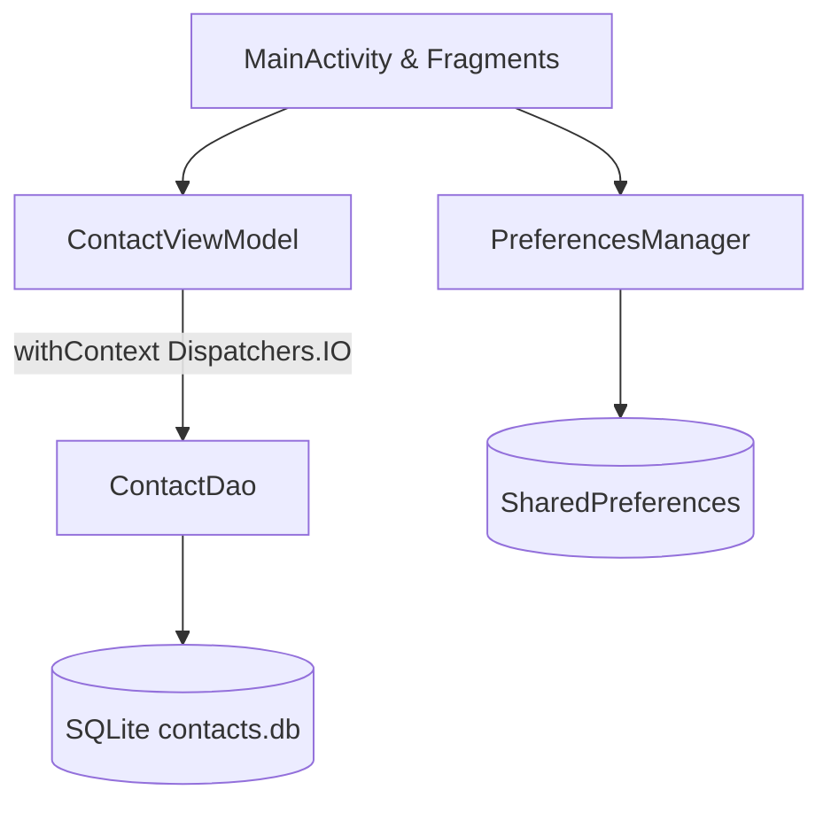

# TP Android — Gestion des contacts (VERSION 4)

**Auteur** : Maram Hsoumi  
**Technologies** : Kotlin • SQLite Natif (`SQLiteOpenHelper`) • Coroutines (`Dispatchers.IO`) • AndroidX Preference (`SharedPreferences`) • Fragments • RecyclerView • Google Maps SDK  

---

## 📌 Présentation et Objectifs
L'application **Contacts V4** introduit la persistance permanente locale et la personnalisation dynamique de l'expérience utilisateur :
1. **Persistance SQLite Locale (`contacts.db`)** :
   - Schéma relationnel complet géré par l'API native Android (`SQLiteOpenHelper`, `SQLiteDatabase`, `ContentValues`, `Cursor`).
   - Architecture en couches dans le package `data` : `ContactContract`, `ContactDbHelper`, `ContactDao`, `Contact`.
   - Toutes les requêtes sont sécurisées via `selectionArgs` avec arguments `?` (protection contre les injections SQL et les apostrophes).
   - Accès asynchrone hors du thread principal via Kotlin Coroutines (`withContext(Dispatchers.IO)`).
2. **Opérations CRUD Complètes intégrées à l'UI** :
   - **Create** : Bouton d'action flottant FAB « + » ouvrant la création d'un nouveau contact.
   - **Read** : Liste et consultation détaillée chargées directement depuis SQLite.
   - **Update** : Modification des informations, photo et géolocalisation enregistrées en base.
   - **Delete** : Bouton « Supprimer » avec boîte de dialogue de confirmation `AlertDialog`.
3. **Préférences Utilisateur (`SharedPreferences` & `PreferenceFragmentCompat`)** :
   - Écran `ParametresFragment` : réglage de la taille de police, couleur de texte préférée et activation du bouton d'appel direct sur chaque ligne de la liste.
   - Application **immédiate** des préférences dès le retour sur la liste (via `onResume`).
4. **Persistance pérenne des photos** :
   - Copie systématique des images dans le stockage interne de l'application (`context.filesDir`) pour éviter l'invalidation des URIs après redémarrage.

---

## 🏛️ Architecture & Diagramme de Flux

---

## ❓ Réponses aux Questions de Compréhension (Section 10)

### 1. Quand les méthodes `onCreate` et `onUpgrade` d'un `SQLiteOpenHelper` sont-elles appelées ? Que se passe-t-il si l'on modifie `onCreate` sans changer la version ?
- **`onCreate`** est appelée **uniquement** lors du premier accès à la base (lecture ou écriture) lorsque le fichier de base de données (ici `contacts.db`) n'existe pas encore sur le disque.
- **`onUpgrade`** est déclenchée automatiquement lorsque le numéro de version transmis au constructeur (`DATABASE_VERSION`) est strictement supérieur à la version actuellement stockée dans l'en-tête du fichier de base de données.
- **Si l'on modifie `onCreate` sans incrémenter la version** : Sur un appareil où `contacts.db` existe déjà, `onCreate` ne sera **jamais réexécutée**. Les modifications apportées au schéma (nouvelles tables, colonnes) ne seront donc pas appliquées, provoquant des erreurs `SQLiteException: no such column / table`. Il faut soit désinstaller l'application, soit incrémenter `DATABASE_VERSION` et coder la migration dans `onUpgrade`.

### 2. Pourquoi utiliser des arguments `?` plutôt que concaténer les valeurs dans une requête SQL ? Donnez un exemple d'entrée qui casse une requête concaténée.
- **Sécurité et intégrité** : L'utilisation de `?` (`selectionArgs`) permet au moteur SQLite de traiter les valeurs comme de purs paramètres de données, et non comme du code exécutable. Cela prévient les failles d'**injection SQL** et évite les erreurs de syntaxe sur les caractères spéciaux.
- **Exemple de rupture** :  
  Si l'on concatène la saisie :  
  `val sql = "SELECT * FROM contacts WHERE nom = '" + saisie + "'"`  
  Si l'utilisateur s'appelle **O'Neil** ou recherche une ville comme **L'Ariana**, la requête générée devient :  
  `SELECT * FROM contacts WHERE nom = 'O'Neil'`  
  Le guillemet simple `'` ferme prématurément la chaîne littérale, SQLite rencontre `Neil` non reconnu et lève un crash fatal `SQLiteException: syntax error (code 1)`. Avec `?`, `'O'Neil'` est correctement échappé et traité sans aucune erreur.

### 3. Que renvoient `insert()`, `update()` et `delete()` ? Comment exploitez-vous ces valeurs dans l'interface ?
- **`insert()`** renvoie l'identifiant de la nouvelle ligne insérée (`_id: Long`), ou `-1L` en cas d'échec :
  - *Exploitation UI* : Si `id != -1L`, on affiche un Toast confirmant l'enregistrement et on retourne à la liste ; si `id == -1L`, on affiche une alerte d'erreur à l'utilisateur.
- **`update()`** renvoie le nombre de lignes modifiées (`Int`) :
  - *Exploitation UI* : Si la valeur est $> 0$, la mise à jour est confirmée.
- **`delete()`** renvoie le nombre de lignes supprimées (`Int`) :
  - *Exploitation UI* : Si la valeur est $\ge 1$, on notifie l'utilisateur via un Toast et on dépile le fragment pour revenir à la liste mise à jour.

### 4. Pourquoi l'accès à la base ne doit-il pas se faire sur le thread principal ? Comment l'avez-vous évité ?
- Les lectures/écritures sur support physique (I/O disque) sont des opérations bloquantes d'une durée imprévisible. Si elles s'exécutent sur le **Main Thread** (thread UI), l'interface se fige, causant des saccades (jank) et, si le blocage excède 5 secondes, une boîte de dialogue fatale **ANR (Application Not Responding)**.
- **Implémentation** : Nous utilisons les coroutines Kotlin au sein du `viewModelScope` avec un basculement explicite de contexte d'exécution : `withContext(Dispatchers.IO) { ... }`. Les accès disques s'effectuent sur le pool de threads dédié aux entrées/sorties, puis les données sont renvoyées au thread principal via `LiveData`.

### 5. Pourquoi le helper doit-il être unique et construit avec `applicationContext` ?
- **Singleton unique** : Ouvrir simultanément plusieurs instances de `SQLiteOpenHelper` sur le même fichier de base de données peut provoquer des verrous concurrents (`database is locked`) ou des corruptions de données.
- **`applicationContext`** : Si l'on passait le contexte d'une `Activity`, la conservation d'une référence statique vers cette Activity dans l'instance singleton empêcherait le Garbage Collector de la libérer après sa destruction, générant une fuite de mémoire critique (**Memory Leak**). L'`applicationContext` est lié au cycle de vie global du processus de l'application.

### 6. SharedPreferences ou SQLite : selon quels critères choisir l'un ou l'autre ? Justifiez le choix fait pour les contacts et pour les préférences.
- **Critères** :
  - **`SharedPreferences`** : Conçu pour des données simples scalaires sous forme de paires clé/valeur (booléens, chaînes, entiers). L'ensemble du fichier XML est chargé en mémoire vive. Non adapté aux volumes importants ni aux requêtes complexes (recherche, tri, jointures).
  - **`SQLite`** : Système de gestion de base de données relationnelle complet. Conçu pour de volumineux jeux de données structurées, requêtes filtrées (`WHERE`, `LIKE`), tris (`ORDER BY`) et transactions ACID.
- **Justification** :
  - Les **contacts** possèdent de multiples champs interdépendants, des coordonnées optionnelles, des photos, et nécessitent des recherches textuelles rapides et des tris alphabétiques : **SQLite** est obligatoire.
  - Les **préférences utilisateur** (taille de police, couleur, booléen du bouton d'appel) sont des paramètres de configuration élémentaires clé/valeur : **SharedPreferences** est optimal, léger et parfaitement standardisé.

### 7. Comment les préférences modifiées sont-elles appliquées à la liste sans redémarrer l'application ?
Dans `ListeContactsFragment`, la méthode de cycle de vie `onResume()` est systématiquement appelée dès que l'écran redevient visible (notamment lors du retour arrière depuis `ParametresFragment`). Dans `onResume()`, nous interrogeons `PreferencesManager.getPreferences()`, transmettons les nouvelles valeurs à l'Adapter via `adapter.actualiserPreferences(nouvellesPrefs)`, qui appelle `notifyDataSetChanged()` pour rafraîchir immédiatement toutes les lignes visibles.

### 8. Quelle différence existe-t-il entre `ACTION_DIAL` et `ACTION_CALL`, notamment en matière de permissions ?
- **`Intent.ACTION_DIAL`** : Ouvre le composeur téléphonique du système avec le numéro prérempli. L'utilisateur garde le contrôle final et doit appuyer lui-même sur le bouton vert d'appel. **Aucune permission Android (`CALL_PHONE`) n'est requise**, ce qui garantit la conformité et la sécurité.
- **`Intent.ACTION_CALL`** : Déclenche l'appel téléphonique immédiatement sans afficher le clavier ni demander confirmation à l'utilisateur. Cette action exige obligatoirement la permission dangereuse `android.permission.CALL_PHONE` déclarée dans le Manifest et accordée explicitement par l'utilisateur au runtime (boîte de dialogue de permissions).

### 9. Que deviennent la base et les préférences lorsque l'application est désinstallée ? Et lorsque l'utilisateur efface les données de l'application ?
- **Désinstallation de l'application** : Tout le répertoire privé `/data/data/<package_name>/` est intégralement supprimé par le système Android. La base `contacts.db` ainsi que le fichier XML des `SharedPreferences` et les photos enregistrées dans `filesDir` sont définitivement effacés.
- **Effacement des données depuis les paramètres système** : L'opération supprime également tous les fichiers locaux (base SQLite, préférences, cache, stockage interne). L'application revient à son état initial "post-installation" : au prochain lancement, `ContactDbHelper.onCreate()` sera réexécuté et réinsérera les contacts de démonstration.

---

## 🎁 Bonus implémentés (Section 11)
- **Gestion sécurisée des noms avec apostrophe** : Aucune injection ni plantage lors de la saisie d'un nom comme « O'Neil » ou « L'Ariana ».
- **Gestion optimisée des photos en stockage local (`filesDir`)** : Traitement par coroutines pour copier les bitmaps en mémoire interne non volatile.
- **Filtrage textuel directement en SQL via clause `LIKE ?`** : Optimisation des performances avec gestion de la casse `COLLATE NOCASE`.
